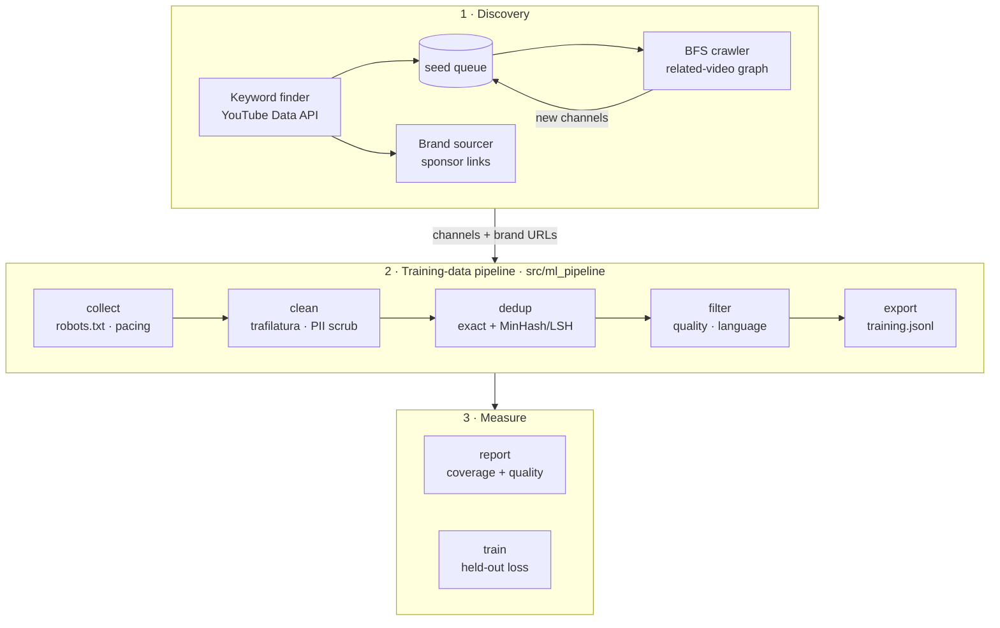

# youtube-creator-crawler

[](https://github.com/mbader099/youtube-creator-crawler/actions/workflows/ci.yml)

A polite web crawler plus an ML training-data pipeline. It discovers sources by walking
YouTube's recommendation graph, fetches and extracts the content behind them, and turns
the crawl into a deduplicated, quality-filtered, training-ready dataset. It also
produces a coverage/quality report and runs a small fine-tune that measures the result.

> **About this project.** This is a personal side project I built for fun. It started
> as a tool for my own creator-research workflow, so many defaults (niche keywords,
> channel filters, Google Sheets as the store) are tuned to my liking rather than to
> general use. The engineering problems are real ones: crawling politely, extracting
> text from messy HTML, deduplicating, measuring data quality.

## Results from a real run

The input was the crawler's own output: 79 brand websites and 278 creator channels it had discovered.

| Stage | Records |
|---|---|
| Raw documents collected | **3,151** (385 web pages + 2,766 video descriptions) |
| After HTML extraction + normalisation | 3,120 |
| After dedup | 3,022 (29 exact + **69 near-duplicates caught by MinHash/LSH** that exact matching missed) |
| After quality + language filtering | **2,096** (each drop attributed to a reason) |
| Final dataset | **2,096 records · ~936k tokens · 0 emails/URLs/handles left** |

**Fine-tune check:** `distilgpt2` trained on 450 records, evaluated on 50 held-out records,
1 epoch, about 2 minutes on a laptop GPU.

| | Held-out loss | Perplexity |
|---|---|---|
| Before | 3.952 | 52.0 |
| After | **3.643** | **38.2** |

Full breakdown and method: [`src/ml_pipeline/README.md`](src/ml_pipeline/README.md).

## Engineering highlights

**Crawling and discovery**
- **Queue-based BFS** over YouTube's related-video graph: a `deque` frontier, hop limits,
  a cheap pre-filter on every edge, and per-node expansion caps. It reaches sources keyword
  search never surfaces, and a persistent seed queue chains runs together.
- **Dedup at every layer**: visited URLs, one expansion per channel, a cross-run processed
  cache, and canonicalised source names.
- **Circuit breakers**: the crawl stops on consecutive empty pages or navigation errors,
  keeps its seeds pending for retry, and skips writes on a flagged run.

**Politeness and compliance**
- The collection adapter honours `robots.txt`, paces requests per host, retries 429s
  honouring `retry-after`, and sets explicit timeouts on every request.
- **Human-in-the-loop CAPTCHA handling**: the crawler pauses and alerts the operator.
  It never solves or bypasses a CAPTCHA.
- **PII scrubbing** before export: emails, URLs and `@handles` become placeholders. A
  line-aligned provenance file (source, URL, language) is kept outside the training file.

**Extraction, dedup, filtering**
- Main-content extraction from messy HTML with trafilatura (drops nav, footers, cookie
  banners, scripts), plus Unicode NFKC normalisation and whitespace collapse.
- **Exact dedup** (content hash) followed by **MinHash + LSH near-dedup** (128 permutations,
  word 5-gram shingles, Jaccard ≥ 0.8). LSH keeps it sub-quadratic.
- Quality heuristics (length, symbol ratio, link density, repeated lines, boilerplate),
  then language ID against a configurable keep-set.

**Measuring data quality**
- A coverage/quality report: the funnel per stage, drops by reason, dedup rate with example
  pairs, a language breakdown, and per-source yield.
- A fine-tune evaluated on **held-out** data, so the dataset's effect is measured, not asserted.

**Engineering hygiene**
- CI on every push: tests on Python 3.10 and 3.13, lint, and a crawler smoke test.
- Pinned dependencies, secrets only from env/`.env`, scraped data git-ignored by default.
- **Loud failures**: every fetch or API error is counted and reported, never swallowed.

## Architecture



Design notes: [`docs/architecture.md`](docs/architecture.md) (crawler) ·
[`src/ml_pipeline/README.md`](src/ml_pipeline/README.md) (data pipeline).

## Quick start

Requires Python 3.10+. All dependencies install from prebuilt wheels; no system packages are needed.

```bash
git clone https://github.com/mbader099/youtube-creator-crawler.git
cd youtube-creator-crawler
python3 -m venv .venv && source .venv/bin/activate
pip install -r requirements.txt -r src/ml_pipeline/requirements.txt
python -m playwright install chromium
cp .env.example .env      # add YOUTUBE_API_KEY (+ Google Sheets creds for the crawler's sheet output)
cd src
```

**Training-data pipeline**

```bash
# inputs are the crawler's outputs: channel_cache.json (finder) + a CSV export of the Brands tab
python -m ml_pipeline collect --brands-csv Brands.csv --channel-cache channel_cache.json
python -m ml_pipeline run                  # clean → dedup → filter → export → report
python -m ml_pipeline run --langs en,de,es # keep more languages
python -m ml_pipeline.train                # fine-tune check, held-out loss before/after
python -m pytest ml_pipeline/tests -q
```

**Crawler**

```bash
python influncers_yt_finderScript.py                       # keyword discovery → seed queue
python rabbit_hole_crawler.py --setup                      # one-time: browser profile
python rabbit_hole_crawler.py --from-queue --seeds 5 --hops 3 --source
python rabbit_hole_crawler.py VIDEO_ID --crawl --hops 2 --target 25
```

Every script supports `--help`.

## Scope and limitations

This runs on one machine, at thousands of documents rather than billions. At web scale
the same stages would change shape:

- **Frontier:** shard the URL frontier by host, so per-host politeness holds across many
  workers; use a Bloom filter for seen-URL checks.
- **Dedup:** shard the LSH index (or switch to banded MinHash over a distributed join)
  instead of holding it in memory.
- **Storage:** stream the stages and write raw fetches as WARC files, instead of
  in-memory lists and JSONL.
- **Freshness:** recrawl with conditional requests (`ETag` / `If-Modified-Since`) on a
  per-source schedule.

## Also in the repo: brand and contact tooling

The original personal use case. Brands found sponsoring creators are enriched from their
homepages and resolved to a contact. `brand_sourcer.py` detects sponsor links in video
descriptions (affiliate/shortener filtering, DNS liveness, canonical names).
`brand_enricher.py` and `brand_contact_finder.py` fetch brand sites with fallbacks for
pages that reject plain HTTP clients. `email_verifier.py` runs free local checks
before any metered provider. LLMs are only used as yes/no gates and a ranker, with
names grounded in scraped source text and a keyword fallback when no key is set.

```bash
python brand_sourcer.py @SomeCreator --dry-run
python brand_enricher.py --limit 10 --dry-run
python brand_contact_finder.py "Acme VPN" https://acme-vpn.example
```

Example output shape (fake data): [`examples/sample_output.example.csv`](examples/sample_output.example.csv).

## Responsible use

Crawl at human pace and stop when a site pushes back. Respect each site's terms and
`robots.txt`, YouTube's Terms of Service, and the YouTube Data API quota. Training
datasets built with this tool should respect the source content's licensing.
Contact data is for individual, reviewed messages only (CAN-SPAM, GDPR), never bulk sending.

## Security

```bash
pip install pip-audit
pip-audit -r requirements.txt -r src/ml_pipeline/requirements.txt
```

Never commit `.env`, service-account JSON, or scraped data. `.gitignore` blocks all of them by default.

## License

[MIT](LICENSE)
