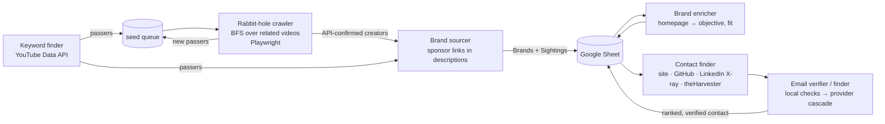

# youtube-creator-crawler

[](https://github.com/mbader099/youtube-creator-crawler/actions/workflows/ci.yml)

Discover YouTube creators that keyword search can't find, detect the brands already
paying them, and resolve each brand to a verified decision-maker contact. The whole
pipeline runs on free API tiers and open-source tooling.

```
find creators ─▶ crawl the related-video graph ─▶ source sponsors ─▶ enrich brands ─▶ find + verify contacts
```

Keyword search only surfaces creators who rank for the terms you thought of. A large
share of a niche can only be reached by **association**: the channels YouTube
recommends next to the ones you already know. This project treats the related-videos
sidebar as a graph and walks it breadth-first. It API-confirms every discovery, then
mines each creator's recent video descriptions for sponsor links. That turns a list
of channels into a list of brands with a proven creator-marketing budget, each with
a ranked, verified contact.

## Engineering highlights

- **Queue-based BFS crawler**: `deque`-driven, hop-bounded traversal of YouTube's
  related-video graph with a cheap pre-filter on every edge, per-node expansion caps,
  and a persistent seed queue that chains runs together.
- **Dedup at every layer**: visited videos, one expansion per channel, a cross-run
  processed cache, sheet-aware skips, canonical brand names, and
  `(brand, creator, link)` sighting keys.
- **Polite by construction**: randomised human pacing, `retry-after`-aware 429
  backoff, explicit timeouts on every request, and a real browser User-Agent.
- **Circuit breakers**: the crawl bails on consecutive empty sidebars or nav errors,
  keeps seeds pending for retry, and skips writes on a flagged run.
- **Human-in-the-loop CAPTCHA handling**: the crawler detects the interstitial,
  pauses, and alerts the operator. It never tries to solve or bypass a CAPTCHA.
- **Escalating fetch ladders**: `urllib` → `curl_cffi` (Chrome TLS fingerprint) →
  headless browser; `crawl4ai` → `Scrapling` → `urllib`; `ddgs` → DDG HTML → Serper.
  Hosts that block once are remembered and skip straight to the next tier.
- **Credit-aware verification cascade**: free local checks (syntax, MX, disposable,
  role inbox) run first. Metered providers are only called when the answer is still open.
- **Grounded LLM use**: LLMs are only cheap yes/no gates plus a ranker. Any contact the
  model names must appear in the scraped source data. Every gate has a keyword-rule
  fallback, so no LLM key is required.
- **Loud failures**: provider errors are counted and reported, never swallowed.

Full design notes: [`docs/architecture.md`](docs/architecture.md).

## Architecture



| Module | Role |
|---|---|
| `src/influncers_yt_finderScript.py` | Keyword search, channel filters, writes passers, seeds the queue |
| `src/rabbit_hole_crawler.py` | Playwright BFS crawler, circuit breakers, CAPTCHA pause |
| `src/brand_sourcer.py` | Sponsor detection, junk/affiliate filter, DNS liveness, dedup |
| `src/brand_enricher.py` | Homepage fetch ladder → brand objective + niche fit |
| `src/brand_contact_finder.py` | OSINT contact discovery, ranking, write-back |
| `src/email_verifier.py` / `src/email_finder.py` | Verification + finder cascades |
| `src/config.py` | Key registry, per-provider rate limits, hardened HTTP client |
| `src/envfile.py` | Zero-dependency `.env` loader |

## Setup

Requires Python 3.10+. macOS is assumed for the desktop CAPTCHA alerts, which are
optional and fail silently elsewhere.

```bash
git clone https://github.com/<you>/youtube-creator-crawler.git
cd youtube-creator-crawler
python3 -m venv .venv && source .venv/bin/activate
pip install -r requirements.txt
python -m playwright install chromium
crawl4ai-setup            # optional: enrichment backend
scrapling install         # optional: stealth fetch backend
cp .env.example .env      # then fill in your keys
```

**Required:** `YOUTUBE_API_KEY`, plus `GOOGLE_CREDS_FILE` (service-account JSON path)
and `SHEET_NAME`. Share the sheet with the service account's email. All other keys are
optional and unlock extra tiers; see [`.env.example`](.env.example).

Secrets are read only from environment variables or the git-ignored `.env`.
Shell-exported variables take precedence over `.env`.

## Usage

Run from `src/`:

```bash
cd src

# 1. Find creators by keyword, write passers, auto-source their sponsors
python influncers_yt_finderScript.py
python influncers_yt_finderScript.py --rabbit-hole        # then crawl the seed queue

# 2. Crawl the related-video graph
python rabbit_hole_crawler.py --setup                     # one-time: prepare the browser profile
python rabbit_hole_crawler.py VIDEO_ID                    # scrape one sidebar (smoke test)
python rabbit_hole_crawler.py --from-queue --seeds 5 --hops 3 --source
python rabbit_hole_crawler.py VIDEO_ID --crawl --hops 2 --target 25   # ad-hoc crawl from one video
python rabbit_hole_crawler.py --seed @SomeCreator --max-views 2000000 --source

# 3. Source sponsor brands for specific creators
python brand_sourcer.py @SomeCreator @AnotherCreator --dry-run
python brand_sourcer.py @SomeCreator --local out.xlsx      # no Google Sheets needed

# 4. Enrich brands from their homepages
python brand_enricher.py --limit 10 --dry-run

# 5. Find and verify contacts
python brand_contact_finder.py "Acme VPN" https://acme-vpn.example
python brand_contact_finder.py --csv 3 --write            # first 3 rows of src/Brands.csv; preview write-back
python brand_contact_finder.py "Acme VPN" https://acme-vpn.example --write --commit   # actually write

# Utilities
python email_verifier.py partnerships@example.com
python email_verifier.py --status                         # which provider keys are live
python config.py                                          # key presence + rate limits (never values)
```

Every script supports `--help`. Example output shape (fake data):
[`examples/sample_output.example.csv`](examples/sample_output.example.csv).

## Responsible use

This tool reads public pages at human pace and stops when a site pushes back. Respect
YouTube's Terms of Service and every target site's terms and `robots.txt`. Keep the
YouTube Data API within its quota. Comply with anti-spam and data-protection law
(CAN-SPAM, GDPR) for any outreach. Contacts are intended for individual, reviewed
messages, not bulk sending.

## Security

```bash
pip install pip-audit
pip-audit -r requirements.txt
```

Never commit `.env`, service-account JSON, or scraped data. `.gitignore` blocks all of
them by default.

## License

[MIT](LICENSE)
